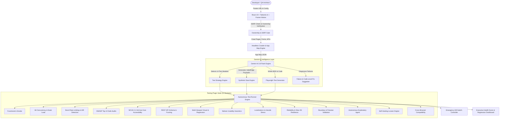

# TestPilot AI 🚀
### AI-Based Synthetic Data Generator & Autonomous Application Tester

TestPilot AI is an autonomous, no-code QA platform that replaces the need for large manual testing teams. Paste the public URL of any web application, and TestPilot AI will:
1. **Intelligently Crawl & Map** the target using headless DOM inspection and network traffic analysis.
2. **Autonomously Select Test Strategies** with Gemini AI, scoring risks and providing technical justifications.
3. **Generate Synthetic Privacy-Safe Edge Data** (boundary values, unicode/RTL, overflows, and safe injection probes) with a 100% PII-free guarantee.
4. **Execute 14 Plugin Modules** with live streaming progress, headless browser screenshots, and an emergency Kill Switch.
5. **Diagnose Failures with AI** to provide root-cause analysis, exact reproduction steps, and code-level fixes.

---

## 🏛️ Architecture & Tech Stack



### Framework Breakdown
- **Frontend (`/src`)**:
  - Framework: React 19 SPA, TypeScript, Vite 8
  - Styling: Tailwind CSS v4, Lucide Icons, Plus Jakarta Sans & JetBrains Mono typography
  - Data Visualizations: Recharts (Pass/Fail Donut, Severity Bar Chart, Latency Timeline)
  - Animation: Framer Motion
- **Backend (`/backend` & `server.ts`)**:
  - Runtime: Node.js (Express server running on port 3000)
  - AI Engine: `@google/genai` TypeScript SDK (`gemini-3.8-flash`)
  - Testing Plugins: Headless browser simulation, axe-core WCAG 2.2 engine, k6-style virtual user load generator
  - Security Guardrails: SSRF protection blocking loopbacks & cloud metadata, DNS TXT & `/.well-known` ownership verification gate
  - Storage: In-memory & JSON file persistence with historical run comparison & audit logs

---

## ⚙️ Environment Variables

Create or configure `.env` based on `.env.example`:

```bash
# GEMINI_API_KEY: Injected automatically by Google AI Studio
GEMINI_API_KEY="your-gemini-api-key"

# Port to bind
PORT=3000
```

---

## 🏃 Quick Start & Demo Script

### 1. Launch Dev Server
```bash
npm install
npm run dev
```

### 2. Demo Walkthrough Script (5-Minute Tour)
1. **Try Demo Mode**: Click **"Demo Mode: ON"** in the top navigation bar. TestPilot immediately loads the pre-configured *ShopSphere Global Commerce* sample target.
2. **Step 1: Submit Target**: View the pre-populated target URL and select between **Quick Smoke**, **Standard QA**, or **Deep Autonomous**.
3. **Step 2: Ownership Verification**: Notice the DNS TXT record (`testpilot-verify=...`) and `/.well-known/testpilot.txt` verification methods. Click **"Verify Ownership Now"** to unlock intrusive security and load testing suites.
4. **Step 3: AI Discovery & App Map**: Explore the interactive node graph showing mapped Storefront pages, interactive forms, and backend `/api/v1/*` routes.
5. **Step 4: AI Test Strategy**: Review the "Selected vs Skipped" table where Gemini provides specific risk scores (0-100) and technical reasons for each of the 14 testing plugins.
6. **Step 5: Synthetic Data & Playwright Code**: Inspect the generated test payloads (valid, boundary, unicode, malicious) and the Given/When/Then BDD test cases with runnable Playwright TypeScript code.
7. **Step 6: Live Execution & Kill Switch**: Click **"Start Autonomous Run"**. Watch the streaming terminal logs and progress bar. Try clicking the red **Kill Switch** to test emergency abort.
8. **Inspect Bugs & AI Fixes**: Click on any failed or warning test card (e.g. Rate Limiting or Accessibility) to open the modal containing AI root-cause diagnosis and code-level fixes.
9. **Standalone Synthetic Data Lab**: Click the **"Synthetic Data Lab"** tab in the navbar to generate custom privacy-safe datasets in CSV, JSON, SQL inserts, or Playwright fixtures.
10. **Regression Trends**: In **"Reports & Dashboard"**, compare Run #1 vs Run #2 to see the +14 point Health Score delta and fixed defects.
